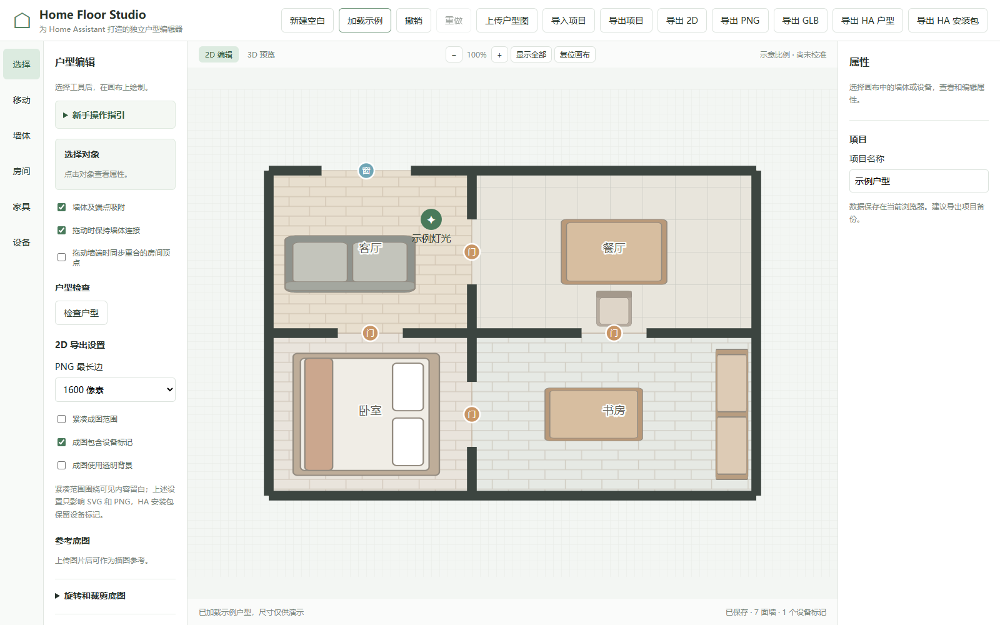
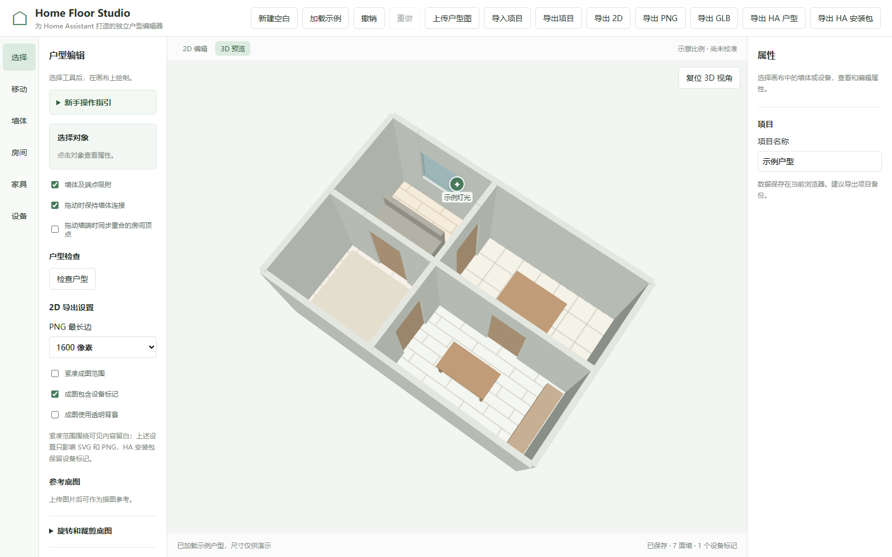

# Home Floor Studio

当前版本和变更记录见 [CHANGELOG](CHANGELOG.md)。

独立户型编辑和生成工具，目标是生成 2D、3D 户型并通过配套组件接入 Home Assistant。

## 界面预览

以下截图来自内置合成示例，用于展示编辑器效果，不代表实际户型或施工图。

### 2D 平面



### 3D 模型



目前处于开发预览阶段：支持新建空白户型、墙体绘制与正交预览、墙身及端点吸附与拖动时保持连接、已知墙长比例校准、门窗开口、常见户型问题检查、房间区域和坐标编辑、从闭合墙体生成房间、参考底图导入（PNG/JPG，最大 5 MB、2400 万像素）、本地旋转、裁剪及四点透视校正、基础家具和设备标记、画布缩放平移与显示全部、撤销重做、浏览器本地保存、项目文件导入导出、SVG、PNG、基础户型 GLB、HA 安装包及完整项目 ZIP 导出。3D 模型包含带门窗开口的墙体、简化门窗和基础几何家具；编辑器及 HA 卡片会按模型范围设置初始 3D 视角；地面由房间区域生成，未创建房间时不生成地面；可在“房间”工具中从闭合墙体生成轮廓，生成依据墙体中心线而非墙内侧，必须人工核对；墙体未闭合、重叠或存在嵌套墙环时需调整或手动绘制；拖动墙体时可保持完全重合的端点连接，也可主动开启完全重合房间顶点的同步移动；未重合的边界不会自动移动，需检查调整；门可选择闭合或按起点/终点铰链向两侧开启，2D 成图与 3D 模型以简化的 90° 门板表示；墙面和家具可在选中后调整颜色，颜色随项目、2D 成图、3D 模型和 HA 户型数据保存；2D 家具以轮廓颜色表达，内部细节保留原配色。2D 和 3D 地面支持纯色、简化木地板和瓷砖纹理。2D 导出范围会扩展以包含原画布外的对象，PNG 最长边可选 1600、2400 或 3200 像素。SVG 和 PNG 可选择是否显示设备标记以及是否使用透明背景；透明仅作用于户型外部，这些设置不影响项目文件及 HA 户型数据。AI 识别目前仅通过模拟服务验证；HA 安装流程已在全新隔离 Home Assistant 2024.12.5 中完成，但家庭 HA 尚未验证。透视校正需手动选点且输出长边不超过 1600 像素；未校准的长度和面积仅供示意，单条墙长校准也无法证明图纸没有变形或其他尺寸准确。HA 卡片已在隔离环境中验证安装和模拟实体交互，家庭 HA 与真实设备仍需用户验收。请勿将户型数据用于施工。

“检查户型”可提示未连接的墙端、墙体中心线重叠、缺少地面、未校准比例以及门窗裁剪或水平重叠等常见问题，并可选择相关对象；检查不能代替完整几何、尺寸和施工核验。

编辑器左侧可展开“新手操作指引”；从底图到导出的完整步骤见 [使用指南](docs/user-guide.md)。

项目备份和 HA 户型数据的版本、字段和区别见 [户型文件格式](docs/project-format.md)。

本地存储、AI 图片发送及各类导出文件的数据范围见 [数据与隐私说明](docs/privacy.md)。

首次打开时是空白户型，可上传自己的图纸或选择“加载示例”体验。加载示例会替换当前项目，刷新前可撤销；请先导出需要保留的项目。已保存的项目会继续恢复。

## 本地开发

适用于已安装 Node.js 和 npm 的开发电脑。`npm install` 会按锁文件安装依赖并产生 `node_modules`；`npm run dev` 在本机启动开发服务器，默认地址为 `http://127.0.0.1:3000/`，不操作 Home Assistant。开发数据优先保存在当前浏览器的 IndexedDB 中；旧版本地数据在读取时保留原副本，首次编辑保存后迁移。清理浏览器数据会丢失项目，建议导出项目备份。保存失败时界面会提示，请及时导出。若启动时本地记录损坏，可先导出原始记录，再从有效项目备份恢复；旧记录保留在本浏览器中，详见使用指南。使用 IndexedDB 时，若多个标签页同时编辑，后保存的旧版本会被拒绝；冲突页面应先导出备份，再重新加载。浏览器不支持 IndexedDB 时使用 localStorage，跨标签页保护仅为尽力检测。

```sh
npm install
npm run dev
```

构建使用 `npm run build`，测试使用 `npm test`，均在本地项目目录执行。

端到端测试使用 `npm run test:e2e`，会先在本地重新构建 `dist/`，再启动无头浏览器验证底图、模拟 AI、编辑、PNG/GLB 和模拟 HA 卡片流程；不会访问真实 AI 服务或 HA。需要已安装 Playwright Chromium，或通过环境变量 `HFS_BROWSER_PATH` 指向已有的兼容 Chromium 浏览器。若选择执行 `npx playwright install chromium`，该命令会联网下载浏览器并占用磁盘空间，适用于安装了项目依赖的开发电脑。默认测试使用虚拟地址拦截静态资源；也可先启动本地预览，再设置环境变量 `HFS_E2E_URL` 指向预览地址以通过真实 HTTP 加载站点。AI 与 HA 仍为模拟，不能替代真实服务验证。

GitHub Actions 会在 `main` 分支推送和 Pull Request 时运行单元测试、构建发布包，并将 ZIP 与 SHA256 文件保存为该次工作流的短期构建产物；不会部署网站或创建 GitHub Release。开发依赖要求 Node.js `^20.19.0 || >=22.12.0`。

构建后 `dist/` 是静态站点，可完整复制到静态服务器的根目录或子目录；请一并保留 `assets/`、`ha-release/` 与 `licenses/`。在本机可用 `npm run preview` 预览，默认地址为 `http://127.0.0.1:3001/`，命令仅启动本地服务。端口被占用时以终端实际显示的地址为准。远程访问应使用 HTTPS，或使用浏览器认可的 localhost 安全上下文；不要通过双击 `index.html` 的 `file://` 方式运行。不同地址的浏览器本地项目互不共享，迁移前请导出项目文件。真实服务器发布尚未验证。

可选 AI 识别的配置与限制见 [AI 辅助识别](docs/ai-recognition.md)。

开发者可在项目目录运行 `npm run package:release`，该命令会重新构建并在 `releases/` 生成带版本号的 ZIP 和 SHA256 校验文件，不会上传或发布。ZIP 内的 `site/` 是可部署的完整静态站点，另含中文使用文档、许可证和文件校验清单。使用者部署 `site/` 时无需安装构建依赖，具体启动、更新与回退步骤见包内“开始使用.txt”。当前为开发预览包，真实 AI 与家庭 HA 尚未验收。

HA 2D/3D 展示卡片的开发预览说明见 [HA 平面图卡片](docs/ha-preview.md)。卡片已在全新隔离的 Home Assistant 2024.12.5 中完成初始化、资源注册、界面添加、模拟实体绑定、状态切换和 3D 显示；家庭 HA 环境仍未验证。

项目非商业使用免费，商业使用须联系授权，具体见 [LICENSE](LICENSE)。构建产物的 `licenses/` 包含项目许可证及第三方运行依赖的原始许可和版本索引；第三方内容遵循各自的许可。
